**Backend or systems engineer** · the public internet

Felix qui potuit rerum cognoscere causas

## Identity, with signal

<table>
<tr>
<td valign="top" width="65%">

Felix qui potuit rerum cognoscere causas

**Focus:** `Python` · `TypeScript` · `C++`

Currently working on a systems design project at NextWork.

</td>
<td valign="top">

`LIVE SIGNAL`

**10** repos 
**2** stars 
**35** contributions 
**1** follower

</td>
</tr>
</table>

## What moves the work

Positioning is useful when the proof is close behind it.

## The tools behind the signal

Python · TypeScript · C++ · HTML · CSS · Tailwind CSS · PostgreSQL · Redis · Vercel · Git · Linux

| Repository | About | Language | ⭐ |
| :-- | :-- | :-- | :-: |
| [**distributed-system**](https://github.com/Mozle941/distributed-system) | — | Python | 0 |
| [**url_shortener**](https://github.com/Mozle941/url_shortener) | A URL shortener | Python | 0 |
| [**hostel-management-system**](https://github.com/Mozle941/hostel-management-system) | A program written in C++ for property management | C++ | 0 |
| [**e-commerce-web-app-development**](https://github.com/Mozle941/e-commerce-web-app-development) | — | TypeScript | 1 |
| [**POLYBOT_LATENCY**](https://github.com/Mozle941/POLYBOT_LATENCY) | A cutting edge market analysis and execution tool | Python | 1 |
| [**Login-Page**](https://github.com/Mozle941/Login-Page) | — | HTML | 0 |
| [**PDF-Audio**](https://github.com/Mozle941/PDF-Audio) | — | Python | 0 |
| [**My_Polybot**](https://github.com/Mozle941/My_Polybot) | A bot for copy trading on prediction markets | Python | 0 |
| [**git-learning-log**](https://github.com/Mozle941/git-learning-log) | My first Git project tracking a learning log | — | 0 |

## The trail behind the work

0 day current streak · 13 active days

KEEP THE SIGNAL MOVING

## Make something worth noticing

Mos_dev · <a href="https://github.com/Mozle941">@Mozle941</a>

