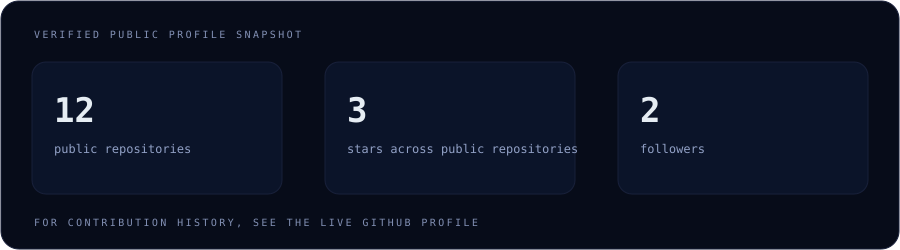

**Felix qui potuit rerum cognoscere causas**

<h1>Felix qui potuit rerum cognoscere causas</h1>

## What moves the work

Language counts reflect the primary language reported for each public repository.

## The tools behind the signal

### 🛠️ Tech Stack

  
  
  
  
  
  
  
  
  
  
  

## Public repositories

| Repository | About | Primary language | ⭐ |
| :-- | :-- | :-- | :-: |
| [Album__Wall](https://github.com/Mozle941/Album__Wall) | — | TypeScript | 1 |
| [distributed-system](https://github.com/Mozle941/distributed-system) | — | Python | 0 |
| [e-commerce-web-app-development](https://github.com/Mozle941/e-commerce-web-app-development) | — | TypeScript | 1 |
| [git-learning-log](https://github.com/Mozle941/git-learning-log) | — | — | 0 |
| [hostel-management-system](https://github.com/Mozle941/hostel-management-system) | A program written in C++ for property management | C++ | 0 |
| [Login-Page](https://github.com/Mozle941/Login-Page) | — | HTML | 0 |
| [My_Polybot](https://github.com/Mozle941/My_Polybot) | A bot for copy trading on prediction markets | Python | 0 |
| [PDF-Audio](https://github.com/Mozle941/PDF-Audio) | — | Python | 0 |
| [POLYBOT_LATENCY](https://github.com/Mozle941/POLYBOT_LATENCY) | A cutting edge market analysis and execution tool | Python | 1 |
| [Portfolio](https://github.com/Mozle941/Portfolio) | An interactive dashboard developer stats | TypeScript | 0 |
| [url_shortener](https://github.com/Mozle941/url_shortener) | — | Python | 0 |

## Profile snapshot

Public profile data refreshed 2026-11-20 · <a href="https://github.com/Mozle941">View live profile on GitHub</a>

## Make something worth noticing

Mos_dev · <a href="https://github.com/Mozle941">@Mozle941</a>

